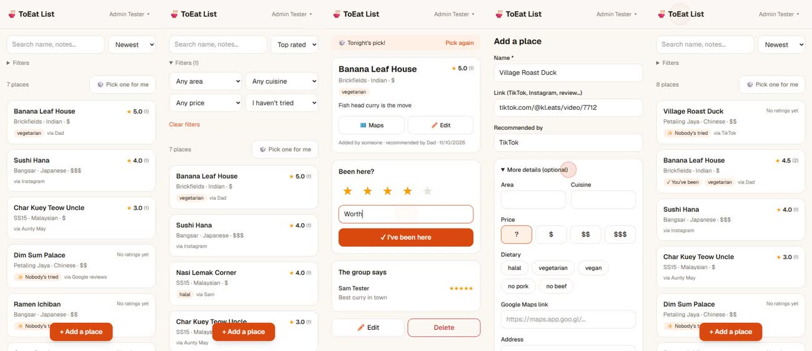

# 🍜 ToEat List

Our group's shared list of places worth eating at. Mobile-first, for about 10 trusted family members or friends.

## Demo

[](demo/toeat-list-demo.mp4)

▶️ **[Watch the 54-second demo](demo/toeat-list-demo.mp4)**: sign in, sort and filter, 🎲 random pick, rate a place, add a new one. It was recorded on a phone-sized screen with local test data.

- Add a place in seconds: name plus a link; everything else is optional.
- Each person marks "I've been here", gives a 1–5 rating and an optional one-liner. The list shows the group average.
- Filter by area, cuisine, price and "not tried yet". Sort by newest, top rated or A–Z. Use 🎲 **Pick one for me**.
- Anyone can edit or delete any place. Deletes go to **Deleted places** and can be restored.
- Only emails on the members list can get in. The admin manages them on the **Members** page.

**Stack:** Next.js 15 (App Router, TypeScript, Tailwind) and Supabase (Postgres, Auth, row-level security), hosted on Vercel.

## Run it locally

Needs Node and Docker Desktop (running).

```bash
npm install
npm run db:start        # local Supabase in Docker; applies migrations + seed
npm run dev             # http://localhost:3000
```

`.env.local` must contain the local API URL and anon key. Get them with `npx supabase status`.

**Signing in locally:** Google isn't configured locally, so use the emailed code instead. Enter `admin@example.test` (admin) or `sam@example.test` (member). The email with the 6-digit code lands in Mailpit at <http://localhost:54324>.

After changing `supabase/config.toml` or `supabase/templates/`, restart with `npx supabase stop` then `npm run db:start`.

`npm run db:reset` wipes the local DB and re-applies `supabase/migrations` and `supabase/seed.sql`.

## Deploy (free tiers)

1. **GitHub:** push this repo.
2. **Supabase:** create a project, then:
   ```bash
   npx supabase login
   npx supabase link --project-ref <your-project-ref>
   npx supabase db push            # creates tables, rules and the list view
   ```
   In the SQL editor, add yourself as the first admin:
   ```sql
   insert into public.members (email, display_name, is_admin)
   values ('your.email@gmail.com', 'Your Name', true);
   ```
   (Don't run `seed.sql` in production. It only holds test data.)
3. **Google sign-in:**
   - In Google Cloud Console → APIs & Services → Credentials, create an **OAuth client ID** (Web application).
   - Authorized redirect URI: `https://<your-project-ref>.supabase.co/auth/v1/callback`
   - Paste the client ID and secret into Supabase → Authentication → Sign In / Providers → **Google**.
   - In the same page, under **Email**: keep it enabled (it's used for sign-in codes), and keep **Confirm email** turned **on**. Access is only granted to confirmed emails.
   - Authentication → Emails → **Magic Link** and **Confirm signup** templates: replace the body with the contents of `supabase/templates/sign_in_code.html` (it sends `{{ .Token }}`, a 6-digit code, instead of a link).
4. **Vercel:**
   - Import the GitHub repo.
   - Set env vars `NEXT_PUBLIC_SUPABASE_URL` and `NEXT_PUBLIC_SUPABASE_ANON_KEY`, from Supabase → Project Settings → API.
5. **Supabase → Authentication → URL Configuration:**
   - Site URL: `https://<your-app>.vercel.app`
   - Redirect URLs: `https://<your-app>.vercel.app/auth/callback`
6. Open the site, sign in, go to **Members**, and add the rest of the group.
   - On a phone: **Share → Add to Home Screen** (iOS) or **⋮ → Install app** (Android).

## How access works

Security is enforced in the database (`supabase/migrations/`), not just the UI. Membership is tied to a confirmed sign-in, never just to the email someone claims.

| | Members | Admin | Signed in but not on the list |
|---|---|---|---|
| See places, ratings and members' names | ✅ | ✅ | ❌ sees nothing |
| See members' emails and admin flags | ❌ (only own) | ✅ | ❌ |
| Add / edit / soft-delete / restore any place | ✅ | ✅ | ❌ |
| Hard-delete a place | ❌ | ❌ | ❌ |
| Add / change / remove **own** rating | ✅ | ✅ | ❌ |
| Change someone else's rating | ❌ | ❌ | ❌ |
| Add / remove members | ❌ | ✅ (not themselves) | ❌ |

## Later (v2 ideas)

Photos, auto-filling details from a Google Maps link, "near me" / map view, notifications, and a one-off import of any existing list.
